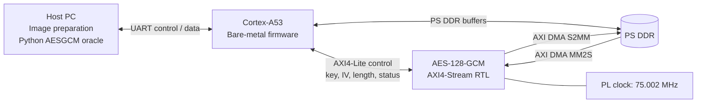
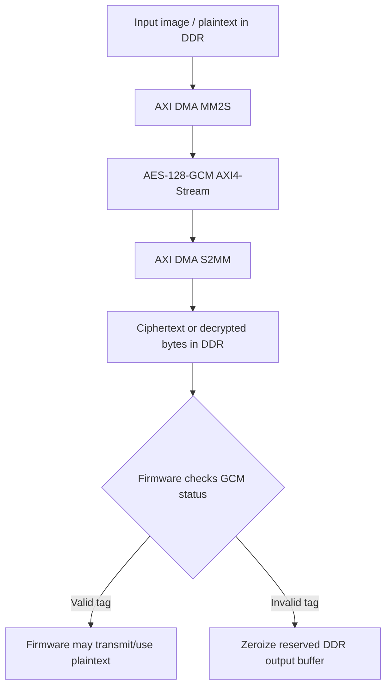
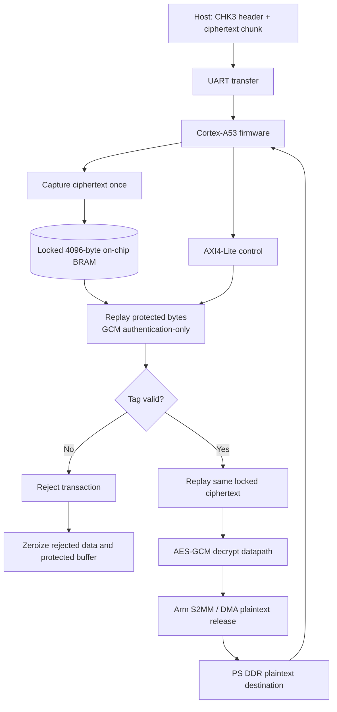

# FPGA AES-GCM System Architecture

This document separates the two implemented FPGA data paths. They share the ZCU104 platform and AES-GCM functionality, but they do **not** provide identical plaintext-release guarantees.

## 1. Platform-level architecture

The system is implemented on the ZCU104 Zynq UltraScale+ MPSoC. The processing system (PS) runs a bare-metal Cortex-A53 application; the programmable logic (PL) contains the AES-GCM accelerator and DMA datapath.

The host prepares image transactions and independently checks FPGA ciphertext and authentication tags with Python's `AESGCM`. The Cortex-A53 configures the accelerator through AXI4-Lite. Payload bytes move through the AXI4-Stream datapath using AXI DMA.

## 2. Baseline `gcm_dma` path

For decryption, the baseline firmware checks the authentication result before transmitting plaintext. On rejection it zeroizes the reserved DDR output buffer. However, unauthenticated decrypted bytes can temporarily occupy that DDR buffer before firmware checks the result. This path should therefore not be described as on-chip plaintext quarantine.

## 3. Protected-chunk path

Each CHK3 transaction carries a 32-byte header and a payload of at most 4096 bytes. A 16-byte metadata field from the header is authenticated as GCM AAD.

The security-relevant order is:

1. Capture the ciphertext into the on-chip buffer.
2. Lock the buffer so the authenticated bytes cannot be replaced between passes.
3. Run authentication-only GCM while S2MM is disarmed.
4. If authentication fails, reject and zeroize; do not start plaintext release.
5. If authentication succeeds, replay the same protected bytes for decryption and arm the plaintext destination.
6. Zeroize the protected buffer after the transaction.

The 16-byte CHK3 metadata field is supplied as AAD. A fresh session nonce and ordered chunk index provide unique per-chunk IVs within the volatile session; this does not establish persistent freshness across resets.

## 4. Trust boundaries and security interpretation

- The Cortex-A53 firmware, PL bitstream, key-loading path and board are trusted by the experiment's threat model.
- UART and stored/transferred ciphertext may be untrusted.
- Python AESGCM is an independent test oracle, not part of the deployed trusted computing base.
- The baseline path prevents firmware from transmitting rejected plaintext but does not quarantine intermediate plaintext in on-chip memory.
- The protected-chunk path holds ciphertext in locked BRAM during authentication and does not arm S2MM until the tag is valid.

Neither path is demonstrated to resist side-channel attacks, fault injection, malicious privileged software or compromised FPGA configuration. The demonstration key is not stored in a secure hardware key vault.

## 5. Implementation parameters

| Parameter | Value |
|---|---:|
| Board | ZCU104 |
| Device | XCZU7EV-FFVC1156-2-E |
| PL clock | 75.002 MHz |
| Cipher | AES-128-GCM |
| Key size | 128 bits |
| IV size | 96 bits |
| Authentication tag | 128 bits |
| Protected buffer capacity | 4096 bytes |
| CHK3 header | 32 bytes |
| Authenticated CHK3 metadata | 16 bytes |
| Data interface | 128-bit AXI4-Stream |
| Control interface | AXI4-Lite |

For the detailed protocol and reproduction steps, see [PROTECTED_CHUNK.md](PROTECTED_CHUNK.md), [SECURITY_MODEL.md](SECURITY_MODEL.md), and [BUILD_AND_RUN.md](../BUILD_AND_RUN.md).

